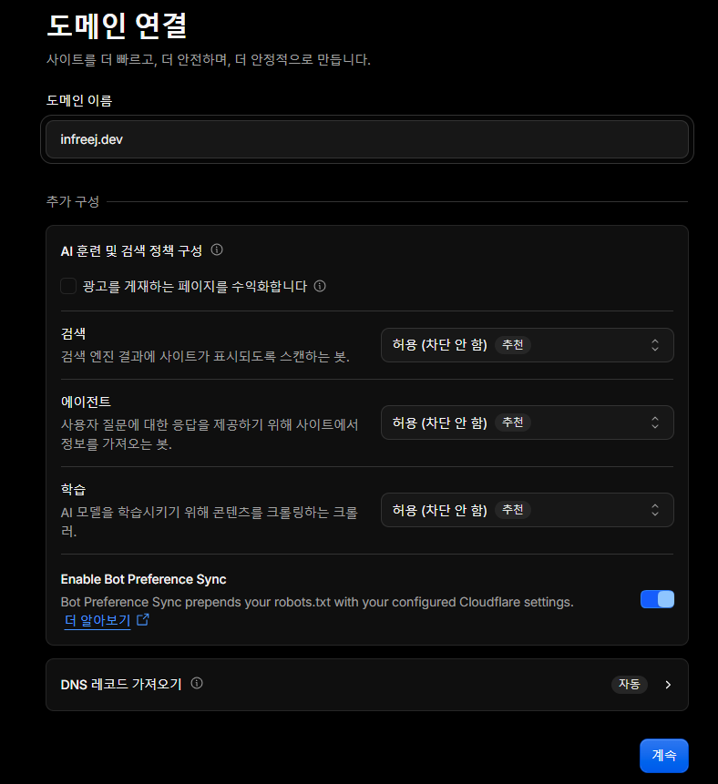
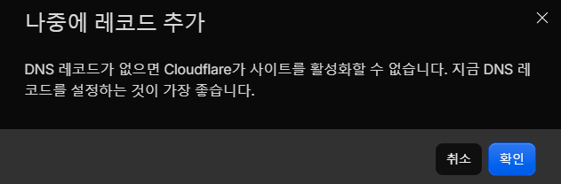
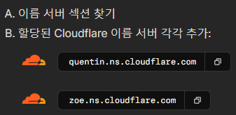
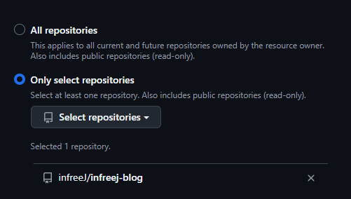
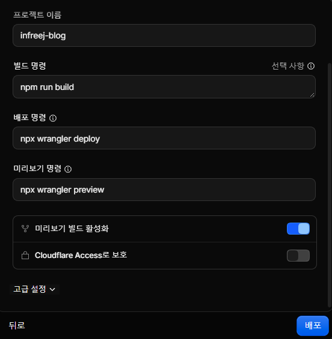

나는 블로그를 꾸준하게 쓰는 사람들이 정말 대단하다고 느낀다. 매번 벨로그나 티스토리 포스팅을 몇 번 작성하다가도 어느샌가 마지막 포스팅 날짜가 3~4달 전인 경우가 많았다. 항상 블로그를 꾸준하게 작성하고 싶다는 생각은 가지고 있지만 맘처럼 되지 않는 게 문제다. 이게 내가 개인 블로그를 만들게 된 계기다.

외부 플랫폼에 의존하지 않고 개인 블로그를 직접 만들어서 운영하면 애착을 가지고 꾸준하게 할.. 수도 있지 않을까..? 하는 생각이 들었고 마침 최근에는 서버 구축에 대한 관심도 높아져서 블로그도 만들고 포스팅도 시작할 겸 블로그 구축 과정을 작성해보기로 했다.

(전체 과정을 모두 상세하게 작성하기엔 무리가 있어서 세부 사항이나 중요하지 않은 부분은 생략했다.)
## Astro와 Cloudflare
우선 최대한 간단히 블로그를 구축할 수 있는 기술 스택을 조사해서 **Cloudflare**와 **Astro**를 사용하는 것으로 결정했다. Astro로 정적 블로그를 만들고, GitHub에 push하면 Cloudflare Workers가 자동으로 빌드/배포하도록 구성했다. 유지비용도 도메인 값을 제외하고는 0원이다.

나는 평소에 Obsidian에 모든 기록을 작성하기 때문에 Obsidian에 작성하던 Markdown 파일을 프로젝트 경로로 복사해서 올리기만 하면 바로 포스팅이 가능하다.


### 1. Cloudflare에 도메인 등록
나는 가비아에서 미리 도메인을 구입해놔서 가비아 도메인의 네임서버를 Cloudflare로 옮기는 작업을 했다. 이렇게 해두면 나중에 Worker에 도메인을 연결할 때 DNS 레코드와 SSL 인증서를 Cloudflare가 자동으로 처리해준다.

> Cloudflare에서 도메인을 구입하면 이 작업이 필요 없다는 것을 나중에 알았다..


Cloudflare 대시보드 사이드바의 `도메인 → 개요`에서 `도메인을 추가하세요` → `도메인 연결`을 누른다.



도메인 이름을 입력하고 나머지는 추천값 그대로 `계속`을 누른다.



DNS 레코드가 없다는 경고가 뜨는데, 블로그용 레코드는 Worker에 도메인을 연결할 때 자동으로 만들어지므로 `확인`을 누르고 넘어간다.



Cloudflare가 할당한 네임서버 2개가 나온다.

가비아의 네임서버 설정에서 기존 가비아 네임서버 3개를 지우고 이 2개만 등록한다.

| 차수 | 변경 전 | 변경 후 |
| --- | --- | --- |
| 1차 | `ns.gabia.co.kr` | `quentin.ns.cloudflare.com` |
| 2차 | `ns1.gabia.co.kr` | `zoe.ns.cloudflare.com` |
| 3차 | `ns.gabia.net` | 삭제 |

변경 후 반영까지 보통 1~2시간, 최대 24시간까지 걸릴 수 있다.


### 2. Astro 프로젝트 생성
```sh
npm create astro@latest -- --template blog
npm run dev
```

`--template blog`로 만들면 글 목록, 상세 페이지, RSS, 사이트맵이 갖춰진 공식 블로그 템플릿으로 시작한다. `http://localhost:4321/`로 확인할 수 있다.


### 3. 사이트 기본 설정
#### astro.config.mjs

```js
export default defineConfig({
    site: 'https://infreej.dev',
    trailingSlash: 'always',
    // ...
});
```

- `site`: 사이트맵, RSS, canonical URL의 기준 주소. 템플릿 기본값 `https://example.com`을 꼭 바꿔야 한다.
- `trailingSlash: 'always'`: URL 끝을 `/`로 통일한다. 내부 링크도 `/blog/`처럼 `/`로 끝나게 맞춰야 불필요한 리다이렉트가 생기지 않는다.

#### src/consts.ts

사이트 제목과 설명을 바꾼다.

```ts
export const SITE_TITLE = 'InfreeJ';
export const SITE_DESCRIPTION = '안녕하세요. 개발자 이준혁입니다.';
```

#### src/content.config.ts
글의 frontmatter 스키마에 `category`, `tags`를 추가하고, URL 규칙을 정했다.

```ts
const blog = defineCollection({
    loader: glob({
        base: './src/content/blog',
        pattern: '**/*.{md,mdx}',
        // 폴더 구조와 상관없이 파일명만 slug로 사용 → /blog/{파일명}/
        generateId: ({ entry }) => entry.split('/').pop()!.replace(/\.mdx?$/, ''),
    }),
    schema: ({ image }) =>
        z.object({
            title: z.string(),
            description: z.string(),
            pubDate: z.coerce.date(),
            updatedDate: z.coerce.date().optional(),
            heroImage: z.optional(image()),
            category: z.string().optional(),
            tags: z.array(z.string()).default([]),
        }),
});
```

`generateId`가 없으면 `src/content/blog/dev/astro.md`는 `/blog/dev/astro/`가 된다. 파일명만 쓰도록 바꿔서 폴더로 글을 분류해도 URL은 `/blog/astro/`로 유지된다. 대신 파일명은 폴더와 상관없이 겹치면 안 된다.

#### 한국어 설정
- `src/layouts/BlogPost.astro`, `src/pages/blog/index.astro`, `src/pages/index.astro`의 `<html lang="en">`을 `lang="ko"`로 바꾼다.
- `src/components/FormattedDate.astro`에서 날짜를 `2026년 10월 31일` 형식으로 바꾼다.

```astro
{date.toLocaleDateString('ko-KR', {
	year: 'numeric',
	month: 'long',
	day: 'numeric',
	timeZone: 'UTC',
})}
```


### 4. 글 작성
`src/content/blog/{파일명}.md`로 작성하면 `/blog/{파일명}/` 주소가 된다.

```markdown
---
title: '첫 번째 글'
description: '테스트용 글입니다.'
pubDate: 2026-10-31
tags: ['test']

---

## 안녕하세요
테스트 글입니다.
```


### 5. Cloudflare Workers 배포 설정
```sh
npm i -D wrangler
```

프로젝트 루트에 `wrangler.jsonc`를 만든다.

```jsonc
{
	"$schema": "./node_modules/wrangler/config-schema.json",
	"name": "infreej-blog",
	"compatibility_date": "2026-10-30",
	"assets": {
		"directory": "./dist",
		"html_handling": "auto-trailing-slash",
		"not_found_handling": "404-page"
	}
}
```


배포 전에 로컬에서 Cloudflare 환경과 같은 방식으로 확인할 수 있다.

```sh
npm run build
npx wrangler dev   # http://localhost:8787
```

설정이 끝나면 GitHub에 저장소를 만들어 push한다.
private 저장소라도 포스팅하는 데는 상관없지만 추후 댓글 기능을 만들 때 GitHub Discussions로는 만들 수 없다는 단점이 있다. 이럴 경우 댓글 전용 public 저장소를 따로 만들어야 하는데 그럴 바에는 그냥 블로그 저장소 자체를 public으로 두는 게 나을 것 같다.


### 6. Cloudflare에 저장소 연결
`Workers 및 Pages` → `애플리케이션 생성` → `Connect GitHub`를 누른다.



`Only select repositories`로 블로그 저장소에만 권한을 준다.



`배포`를 누르고 빌드 로그에 `✨ Success! Build completed.`가 뜨면 배포 성공이다. 이후로는 `main`에 push할 때마다 자동으로 배포된다.


### 7. 도메인 연결

`Workers 및 Pages` → `{workersName}` → `도메인` → `도메인 추가`를 누르고 1단계에서 등록한 도메인 주소를 선택하면 DNS 레코드와 SSL 인증서가 자동으로 설정된다. 몇 분 뒤 해당 도메인 주소로 접속할 수 있다.


### 8. Obsidian 노트를 블로그 글로 변환하기

글은 평소처럼 Obsidian에서 쓰고, 포스팅할 문서만 `src/content/blog/`로 옮기기로 결정했다. 그런데 그대로 복사하면 프론트매터가 블로그 스키마와 맞지 않고 위키링크나 이미지 첨부 같은 Obsidian 문법이 블로그에서 렌더링되지 않는 문제가 있었다.

그래서 이를 자동으로 처리하도록 에이전트 스킬 `obsidian-to-blog`를 만들었다.

이제 글 하나를 발행하는 과정은 다음과 같다.

1. Obsidian에서 글을 쓴다.
2. 변환 스킬로 블로그 글을 만든다.
3. `npm run dev`로 확인하고 `main`에 push한다.


## 마치며
지금 막 만들어서 허허벌판 느낌인데 댓글 기능도 추가하고 디자인도 손보면서 조금씩 다듬어 나가야겠다. 직접 만든 블로그니까 이젠 애착을 가지고 꾸준히 운영했으면 좋겠다...
