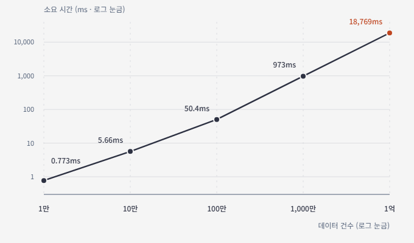

클라이언트가 화면에 개수를 보여줘야 한다면 서버는 간단하게 아래와 같은 쿼리를 작성할 수 있다.

```sql
SELECT COUNT(*)
FROM table
```

하지만 이 Count 쿼리로 나오는 데이터 수가 100만 건 이상이라면 이렇게 단순하게 해결되지는 않는다.


### 데이터 개수 별 소요시간 분석
```sql
EXPLAIN ANALYZE SELECT COUNT(*)
FROM count_items;
```
공통적으로 위 EXPLAIN로 분석했다.


**테스트 환경**
- MySQL 8.0
- CPU 2개, 메모리 4GiB, 버퍼 풀 1GiB 환경
```sql
# 테이블 스키마
CREATE TABLE count_items (
    id BIGINT UNSIGNED NOT NULL,
    category_id INT UNSIGNED NOT NULL,
    status TINYINT UNSIGNED NOT NULL,
    payload VARCHAR(100) NOT NULL,
    created_at DATETIME NOT NULL,
    PRIMARY KEY (id),
    KEY idx_category_id (category_id)
) ENGINE=InnoDB;
```


#### 10,000건
```sql
result -> Count rows in count_items (actual time=0.773..0.773 rows=1 loops=1)
```

실행시간 약 0.0007초

#### 100,000건

```sql
result -> Count rows in count_items  (actual time=5.66..5.66 rows=1 loops=1)\n
```

실행시간 약 0.005초

#### 1,000,000건
```sql
result -> Count rows in count_items  (actual time=50.4..50.4 rows=1 loops=1)
```

실행시간 약 0.05초

#### 10,000,000건
```sql
result -> Count rows in count_items  (actual time=973..973 rows=1 loops=1)
```
실행시간 약 1초

#### 100,000,000건
```sql
result -> Count rows in count_items  (actual time=18769..18769 rows=1 loops=1)
```
실행시간 약 18초


(테스트 데이터 1억 건 삽입하는데 내 노트북이 너무 힘들어 했다..)


#### 분석 결과

개수가 늘어날 수록 쿼리 응답시간이 선형적으로 증가한다.
지금은 쿼리만 실행했지만 만약 실제 서비스 환경이라면 네트워크 지연 등으로 인해 실제 API 응답시간은 더 소요될 것이다.

PK로 인해 인덱싱이 되어 있지만 count 쿼리는 정확한 개수를 세기 위해 모든 행을 순환한다.
`O(N)`의 시간 복잡도로, 데이터가 1억 건이라면 `O(100,000,000)`이 된다.

만약 특정 컬럼에 `Index`가 걸려있고, 해당 `Index`를 사용하도록 유도하는 `WHERE`절이 있다면 조회 건수는 `Index`에 걸리는 행만으로 줄어들겠지만 시간복잡도는 여전히 `O(N)`이기 때문에 건수가 많을 수록 연산이 많아지는 것은 똑같다.


### Google의 count 처리


구글의 페이징 검색은 10개 단위의 페이지만 보여주고 페이지의 끝이 몇번째인지는 보여주지 않는다.
즉, 페이지 계산을 할 때 전체 Count 수를 세지 않고 사용자에게 보여줄 만큼의 수만 센다는 것이다.

물론 `1/2719` 이런 식으로 정확한 현재 페이지와 마지막 페이지를 보여줄 수도 있었겠지만 사용자는 페이지 렌더링마다 구글의 서버가 해당 검색어로 나올 페이지의 총 count를 구한 다음에 그 값으로 페이지 값을 계산하는 시간을 기다려야 할 것이다.

그렇다면 데이터가 많을 때 어떻게 하면 Count를 효과적으로 처리할 수 있을까?


### Count 처리 방식별 장단점
#### 1. Count 안하기

굳이 Count를 보여줄 필요가 없다면 굳이 무거운 Count 연산을 할 필요가 없다.
나도 처음에는 Count 쿼리는 가벼운 연산이라고 생각했지만 그건 프로젝트 초기 단계에서의 얘기였고 규모가 커지면 Count가 큰 병목이 됐었다.

#### 2. 대충 Count 하기

정직하게 개수를 보여줄 필요는 없다. Google처럼 현재 10페이지만큼만 개수를 세면 된다.

```
검색 결과 1~100개 확인
→ 1~10 페이지 표시

검색 결과가 73개에서 끝난다면?
→ 1~8 페이지 표시
```


만약 페이징이 숫자 페이징이 아니라 `이전 페이지 / 다음 페이지`와 같은 구성이라면 더 간단해진다. 현재 페이지 크기보다 딱 한 건 더 조회해서 데이터가 존재한다면 `다음 페이지` 버튼을 활성화 시키면 된다.


#### 3. 비정규화

매번 COUNT 쿼리를 사용하지 않고 테이블에 `count` 컬럼으로 비정규화 해놓는 방식이다. 조회 속도가 `O(1)`로 굉장히 빠르지만 데이터 불일치가 발생할 수 있다.


#### 4. 캐싱

데이터를 빠르게 조회할 수 있도록 미리 캐싱해두고 조회하는 방법이다.
Cache Aside 방식으로 데이터가 캐시 히트라면 바로 보여주고, 캐시 미스가 발생한다면 그 때 DB를 조회할 수 있다. 하지만 이 DB 조회도 지연이 발생해서 개선해야한다면 다음과 같은 방법으로 최소화할 수 있다.

- `ApplicationReadyEvent`를 받아서 서버 기동 시 자동으로 캐시 미스를 체크하고 캐싱
- Cron Job으로 트래픽이 적은 새벽 시간대에 전체 캐싱
- 클라이언트에는 loading과 같은 상태를 임시 응답하고 서버는 캐싱 이벤트를 발행하거나 Queue에 담아서 캐싱 작업 따로 수행

단점은 Redis와 같은 캐시 의존성이 생기고 구현이 복잡해진다는 것


#### 5. EXPLAIN 추정치

꼭 정확한 개수가 아닌 대략적인 개수. 예를 들면 40,000,000+ 와 같은 식으로 보여줘도 된다면 실행 계획을 활용할 수 있다. JPA에서도 native 쿼리를 통해 사용할 수 있다. 실제 조회가 아닌 추정치만 조회하기 때문에 응답 속도가 빠르다.

추정치이기 때문에 페이지네이션 값으로 사용하면 깨질 수 있고, EXPLAIN 쿼리를 파싱해야 한다는 단점이 있다. 따라서 규모감만 주면 되고 페이지 번호와 연동하지 않는 시스템에 적합하다.


### 내가 선택한 방법
진행 중인 프로젝트에서는 정확한 count 수를 보여줘야 한다는 요구사항이 있었기 때문에 캐싱을 사용했다. 캐시 미스일 경우에 DB에 접근하면 API 응답이 너무 느려졌기 때문에 캐시가 필요한 요소를 큐에 넣은 후 즉시 API를 응답하도록 했고 서버 기동 시 즉시 캐싱, Cron Job으로 전체 캐싱 등을 모두 적용해서 캐시 미스가 발생하는 경우를 최소화해서 사용성을 높였다.
